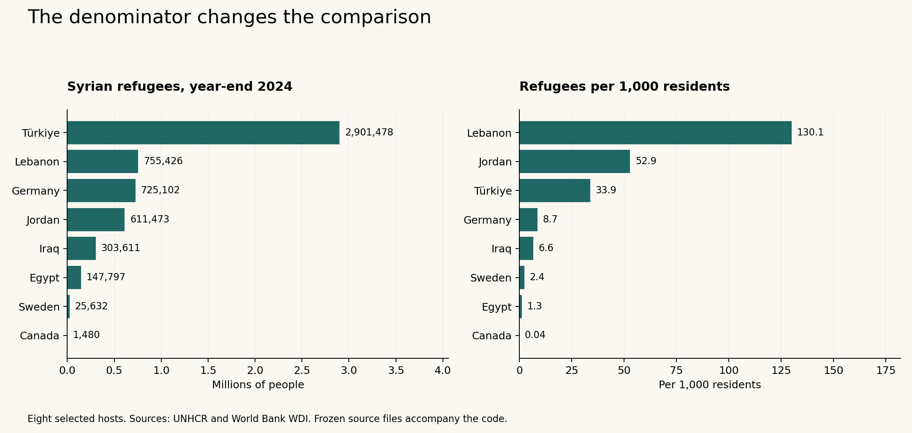

<div dir="rtl" lang="ar">

# قياس اللجوء السوري

## كيف يغيّر المقام الإحصائي خريطة استضافة اللاجئين؟

مشروع يجمع بين الكتابة الأكاديمية والترجمة إلى العربية والتحليل الكمّي القابل لإعادة الإنتاج. يتناول توزيع اللاجئين السوريين بين عامَي ٢٠١١ و٢٠٢٤، اعتمادًا على بيانات منشورة من المفوضية السامية للأمم المتحدة لشؤون اللاجئين والبنك الدولي.

تبدأ الفكرة بسؤال بسيط له نتائج مهمّة في المقارنة السياسية. هل تتصدّر الدول نفسها ترتيب الاستضافة حين نقيس العدد المطلق للاجئين، وحين نحسب عددهم لكل ألف مقيم؟ في عام ٢٠٢٤، تتصدّر تركيا الدول الثماني المختارة من حيث العدد، بينما يأتي لبنان أولًا من حيث النسبة إلى السكان. ويحسب المشروع أيضًا الحصة الإقليمية ومؤشر التركّز، ويقدّم مسردًا يشرح ترجمة المفاهيم الإحصائية إلى العربية.

**اقرأ الورقة العربية الكاملة** عبر الرابط أدناه، أو قارنها بالنص الإنجليزي الذي تُرجمت عنه. يتضمّن المستودع نسخ البيانات المستخدمة والشفرة والجداول والشكلين، حتى يتمكّن القارئ من تتبّع كل نتيجة.

</div>

[الورقة بالعربية](research-note-ar.md) · [English source text](research-note-en.md) · [مسرد الترجمة](translation-glossary.md) · [Data sources](SOURCES.md)



## Research and translation

This project asks how measurement choices change comparisons of Syrian refugee hosting. An original English research note is paired with a full Arabic translation and a bilingual glossary explaining statistical terminology. It combines 14 years of UNHCR data with World Bank resident-population estimates, produces an eight-country panel, and calculates global concentration across all reported destinations outside Syria.

In 2024, Türkiye records **2,901,478** Syrian refugees, versus **755,426** in Lebanon. Their population ratios reverse the comparison, at **33.9** and **130.1** refugees per 1,000 residents respectively. Across all destinations, the share in five regional host countries fell from **93.5% in 2015** to **79.3% in 2024**, while their absolute recorded stock grew.

The article discusses status definitions, registration coverage and the difference between stocks and flows. Country rankings refer to eight selected hosts. The analysis measures hosting patterns, with employment effects and other policy outcomes requiring additional data and a causal research design.

## Reproduce the results

Requires Python 3.10 or later.

```bash
python -m pip install -r requirements.txt
python analysis.py
```

The default run uses the bundled source snapshots and makes no network requests. It verifies checksums, validates the country-year join and rebuilds three tables and two figures. To place regenerated outputs elsewhere, run `python analysis.py --output-dir /path/to/output`.

| Read or inspect | File |
| --- | --- |
| Arabic paper | [research-note-ar.md](research-note-ar.md) |
| English source paper | [research-note-en.md](research-note-en.md) |
| Translation decisions | [translation-glossary.md](translation-glossary.md) |
| Source definitions and attribution | [SOURCES.md](SOURCES.md) |
| Reproducible analysis | [analysis.py](analysis.py) |
| Country-year data | [country-year-panel.csv](country-year-panel.csv) |
| 2024 comparison and sensitivity check | [hosting-2024.csv](hosting-2024.csv) |
| Annual regional share and concentration | [annual-metrics.csv](annual-metrics.csv) |
| Download provenance and source digests | [data-sources.json](data-sources.json) |

Prepared for **Hekmat Matthew Aboukhater’s portfolio**, with AI assistance in research preparation, coding and translation. Data were retrieved on **21 November 2026**. Source organisations retain their data rights. See [SOURCES.md](SOURCES.md) and [LICENSE.md](LICENSE.md) for attribution and reuse.
