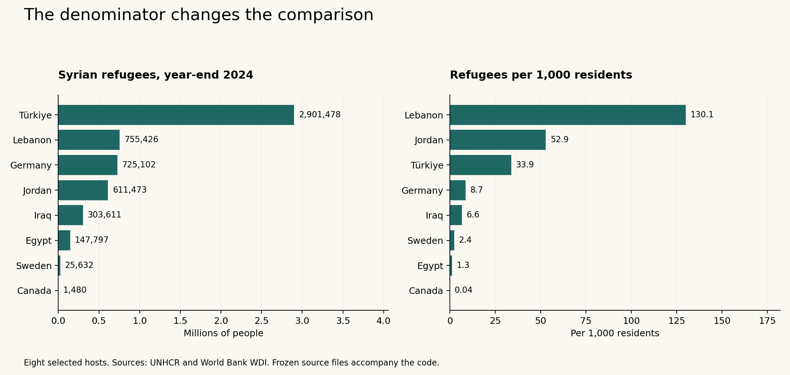
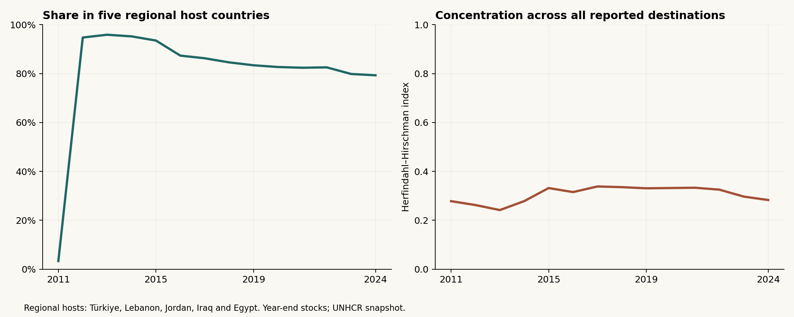

# قياس اللجوء السوري

## كيف يغيّر المقام الإحصائي خريطة استضافة اللاجئين، ٢٠١١–٢٠٢٤

ترجمة عربية للنص التحليلي الإنجليزي المُعدّ لهذا المشروع ضمن ملف أعمال حكمت ماثيو أبو خاطر. أُعدّ النص والترجمة بمساعدة الذكاء الاصطناعي، وأُرفقت البيانات والشفرة لإتاحة التحقّق المستقل من النتائج.

### الملخّص

كيف يؤثّر اختيار المقياس الإحصائي في المقارنة بين الدول المستضيفة للاجئين السوريين؟ تجمع هذه الورقة بين أعداد اللاجئين في نهاية كل سنة، كما توردها المفوضية السامية للأمم المتحدة لشؤون اللاجئين، وتقديرات السكان الصادرة عن البنك الدولي للفترة ٢٠١١–٢٠٢٤. وتقارن بين ثماني دول مختارة، ثم تقيس التوزيع العالمي عبر جميع وجهات اللجوء الواردة في المصدر. في عام ٢٠٢٤، استضافت تركيا، وفق هذه البيانات، ٢٬٩٠١٬٤٧٨ لاجئًا سوريًا، مقابل ٧٥٥٬٤٢٦ في لبنان. وعند احتساب عدد اللاجئين لكل ألف مقيم، ينعكس ترتيبهما، إذ تسجّل تركيا ٣٣٫٩ لاجئًا، ولبنان ١٣٠٫١. وعلى مستوى جميع الوجهات، تراجعت حصة تركيا ولبنان والأردن والعراق ومصر مجتمعةً من ٩٣٫٥٪ عام ٢٠١٥ إلى ٧٩٫٣٪ عام ٢٠٢٤. وتبيّن المقارنة أن الأعداد المطلقة والنسب السكانية ومؤشرات التركّز تجيب عن أسئلة مختلفة تتعلّق بأزمة النزوح نفسها.

### سؤال البحث وأساس المقارنة

لاستضافة اللاجئين بُعدان أساسيان على الأقل. فالعدد المطلق يصف حجم الحماية المقدّمة في وجهة معيّنة، بينما تصف النسبة السكانية حجم السكان اللاجئين الواردين في البيانات قياسًا إلى عدد المقيمين. وتبرز أهمية هذا التمييز عند المقارنة بين دول تتفاوت كثيرًا في حجمها. فقد يحجب الترتيب القائم على الأعداد وحدها الحجم النسبي للاستضافة في دولة صغيرة.

تشمل المقارنة ثماني دول، هي تركيا ولبنان والأردن والعراق ومصر، بوصفها دولًا مستضيفة في المنطقة، إضافةً إلى ألمانيا والسويد وكندا بوصفها وجهات أبعد. ويستند اختيارها إلى صلتها بسؤال البحث. وهي مجموعة مقصودة الاختيار، وليست عيّنة عشوائية أو قائمة بالدول الثماني الأكبر استضافةً. وتخصّ التراتيب الواردة أدناه هذه المجموعة. أمّا المجاميع العالمية ومؤشرات التركّز فتشمل جميع الوجهات الواردة في المصدر خارج سوريا.

### البيانات وبناء مجموعة المشاهدات

يستند البسط إلى حقل أعداد اللاجئين في قاعدة بيانات المفوضية، مع تحديد سوريا بلدًا للأصل والتفصيل بحسب وجهة اللجوء والسنة. وتشمل هذه الفئة، وفق تعريفات المفوضية الإحصائية، الفئات المعنية المشمولة بالحماية المؤقتة. ويستند المقام إلى مؤشر إجمالي السكان الصادر عن البنك الدولي، الذي يعتمد تقديرات منتصف السنة للسكان المقيمين، على اختلاف جنسياتهم. وترد المصادر في ملف المراجع المرفق.

تتكوّن بيانات الدول المختارة من ١١٢ مشاهدة، تغطّي ثماني دول وأربع عشرة سنة. وتُربط السجلات باستخدام رمز الدولة الثلاثي والسنة. وتتحقّق الشفرة من عدم تكرار مفاتيح الربط، وسلامة ملفات المصدر، واكتمال صفحات الاستجابة، وصلاحية القيم العددية، وإيجابية مقامات السكان. ويتوقّف التنفيذ عند وجود قيم مفقودة. كما تُحفَظ الاستجابات الأصلية من دون تعديل، مع توثيق وقت التنزيل وبصمة رقمية لكل ملف.

### المقاييس

إذا رمزنا إلى عدد اللاجئين السوريين الوارد في البيانات في الدولة «ج» عند نهاية السنة «ز» بالرمز «ل»، وإلى عدد سكانها المقيمين بالرمز «س»، فإن كثافة الاستضافة تساوي عدد اللاجئين مقسومًا على عدد المقيمين ومضروبًا بألف. وبذلك تصبح المقارنة بين الدول المختلفة الحجم قابلةً للقراءة على مقياس واحد.

$$D_{ct}=1000\frac{R_{ct}}{P_{ct}}$$

وتساوي حصة كل وجهة من الإجمالي العالمي عدد اللاجئين فيها مقسومًا على مجموع الأعداد في جميع الوجهات الواردة في المصدر. ويقيس مؤشر هيرفندال–هيرشمان التركّز عبر جمع مربّعات هذه الحصص.

$$s_{ct}=\frac{R_{ct}}{\sum_j R_{jt}},\qquad H_t=\sum_c s_{ct}^{2}$$

تبلغ قيمة المؤشر واحدًا عندما تتركّز الاستضافة كلّها في وجهة واحدة. وإذا توزّعت الأعداد بالتساوي على عدد معيّن من الوجهات، ساوى المؤشر مقلوب ذلك العدد. ويعبّر مقلوب المؤشر عن عدد الوجهات المتساوية الحجم الذي يكافئ التوزيع المرصود. أمّا الحصة الإقليمية فتساوي مجموع اللاجئين في الدول الخمس المذكورة مقسومًا على الإجمالي العالمي. وتعتمد هذه المقاييس كلّها الفئة الإحصائية نفسها للاجئين.

### النتائج

تتصدّر تركيا الدول المختارة من حيث العدد المطلق، بنحو ٢٫٩٠ مليون لاجئ سوري في عام ٢٠٢٤. ويليها لبنان بنحو ٧٥٥ ألفًا، ثم ألمانيا بنحو ٧٢٥ ألفًا، والأردن بنحو ٦١١ ألفًا. لكن اعتماد عدد اللاجئين لكل ألف مقيم يضع لبنان أولًا عند ١٣٠٫١، يليه الأردن عند ٥٢٫٩، ثم تركيا عند ٣٣٫٩، بينما تسجّل ألمانيا ٨٫٧. ويعادل العدد في تركيا نحو ٣٫٨ أمثال العدد في لبنان، في حين تعادل كثافة الاستضافة في لبنان نحو ٣٫٨ أمثالها في تركيا.

ظلّت الاستضافة الإقليمية كبيرةً مع اتّساع التوزيع العالمي. فقد استضافت الدول الخمس في المنطقة ٩٣٫٥٪ من إجمالي اللاجئين السوريين الوارد في البيانات عام ٢٠١٥، مقابل ٧٩٫٣٪ عام ٢٠٢٤، بانخفاض قدره ١٤٫٢ نقطة مئوية. وارتفع عدد اللاجئين فيها بين هذين العامين من ٤٬٥٥٦٬٧٣٩ إلى ٤٬٧١٩٬٧٨٥. وهكذا يمكن أن تنخفض حصة مجموعة من الدول بينما يرتفع عدد اللاجئين المقيمين فيها، لأن المقام، أي الإجمالي العالمي، يتغيّر أيضًا.

وانخفض التركّز العالمي بين العامين، إذ تراجع مؤشر هيرفندال–هيرشمان من ٠٫٣٣٢ إلى ٠٫٢٨٣. وارتفع عدد الوجهات المتساوية الحجم المكافئ لهذا التوزيع من ٣٫٠١ إلى ٣٫٥٣، رغم أن ١١٥ وجهة سجّلت أعدادًا موجبةً في عام ٢٠٢٤. ويدلّ ذلك على إمكان انتشار أعداد صغيرة في وجهات كثيرة، مع استمرار تركّز نسبة كبيرة في عدد محدود من الدول.

### فحص الحساسية ودلالة النتائج

تضيف الشفرة أيضًا أعداد طالبي اللجوء الذين ما زالت طلباتهم قيد النظر إلى أعداد اللاجئين في الدول الثماني. وعند توسيع البسط بهذه الطريقة، يبقى ترتيب الدول بحسب عدد اللاجئين وطالبي اللجوء لكل ألف مقيم في عام ٢٠٢٤ كما هو. وتُحفَظ الفئتان منفصلتين في ملفات النتائج كي يتمكّن القارئ من فحص هذا الاختيار في القياس.

توفّر هذه المقاييس أساسًا للمقارنة. ويتطلّب تقدير النفقات العامة أو توافر المساكن أو أثر وصول اللاجئين في التشغيل بياناتٍ عن تلك النتائج واستراتيجيةً لتحديد الأثر السببي. فالقسمة على عدد السكان تضبط اختلاف الحجم بين الدول، بينما يقيس مؤشر التركّز توزيع الأعداد الواردة في البيانات.

### حدود القياس

تختلف أعداد نهاية السنة عن أعداد الوافدين خلال السنة وعن مجموع المقبولين تراكميًا. فالعدد البالغ ١٬٤٨٠ في خانة اللاجئين السوريين في كندا عام ٢٠٢٤ يخصّ تلك الفئة الإحصائية في تلك السنة. ولا يصلح لقياس جميع السوريين الذين قُبلوا أو أُعيد توطينهم أو حصلوا على الجنسية عبر السنوات. وقد تعكس الفروق الزمنية حركة الأشخاص أو تغيّر أوضاعهم القانونية أو مراجعات البيانات. ولا تفصل هذه الورقة بين تلك الآليات.

وتؤثّر إجراءات التسجيل أيضًا في التغطية. فالمفوضية تذكر أن تسجيل السوريين الجدد في لبنان عُلّق في أيار ٢٠١٥، ما يستدعي عنايةً خاصة عند استخدام الأعداد الواردة في القاعدة لتفسير الحجم الكامل للوجود السوري. كما أن مقام السكان وبسط اللاجئين يشيران إلى توقيتين مختلفين داخل السنة الواحدة، وتحجب المعدّلات الوطنية تفاوت التركّز محليًا. وأخيرًا، تعتمد هذه الورقة عام ٢٠٢٤ نهايةً تاريخية ثابتة، ويتطلّب تناول الظروف الراهنة استخراجًا جديدًا للبيانات.

### إعادة إنتاج النتائج

تُثبَّت المكتبات المحدّدة في ملف المتطلّبات، ثم تُشغَّل شفرة التحليل المرفقة. وتقرأ الشفرة النسخ المحفوظة من بيانات المصدر دون اتصال بالشبكة، ثم تعيد بناء الجداول الثلاثة والشكلين. ويشرح المسرد الثنائي اللغة القرارات الاصطلاحية المعتمدة في الترجمة، ومنها التمييز بين العدد القائم في لحظة زمنية وتدفّق الوافدين، وبين النسبة المئوية والنقطة المئوية.

[النص الإنجليزي](research-note-en.md) · [المراجع والبيانات](SOURCES.md) · [المسرد الثنائي اللغة](translation-glossary.md) · [شفرة التحليل](analysis.py)
