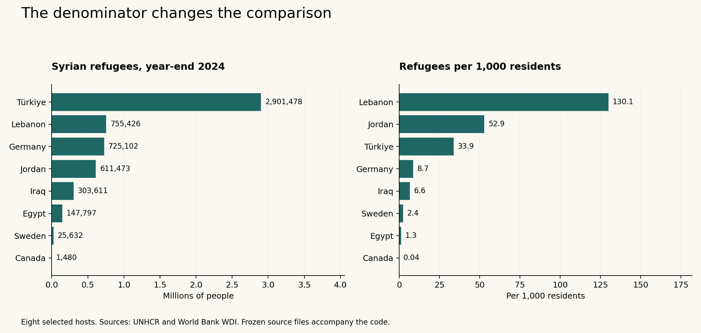
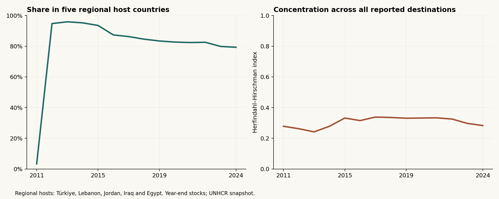

# Counting Syrian displacement

## How denominators change the geography of refugee hosting, 2011–2024

English source text for the [Arabic translation](research-note-ar.md). Prepared for Hekmat Matthew Aboukhater’s research portfolio with AI assistance. Data and code are included for independent verification.

### Abstract

How does the choice of statistical measure shape comparisons of Syrian refugee hosting? This note combines UNHCR year-end refugee stocks with World Bank population estimates for 2011–2024. It compares eight selected host countries and measures the global distribution across all destinations reported in the source. In 2024, Türkiye hosted 2,901,478 Syrian refugees in this dataset, while Lebanon hosted 755,426. Population normalisation reverses their order, yielding 33.9 and 130.1 refugees per 1,000 residents respectively. Across all reported destinations, the share hosted in Türkiye, Lebanon, Jordan, Iraq and Egypt declined from 93.5% in 2015 to 79.3% in 2024. The exercise demonstrates how absolute numbers, population ratios and concentration indices answer different questions about the same displacement crisis.

### Research question and comparison

Refugee hosting has at least two relevant dimensions. An absolute count describes the scale of protection in a destination. A population ratio describes the recorded refugee population relative to the number of residents. These dimensions matter when comparing states of very different sizes. A ranking based on counts alone can obscure the relative scale of hosting in a smaller country.

The eight-country comparison includes five regional hosts—Türkiye, Lebanon, Jordan, Iraq and Egypt—and Germany, Sweden and Canada as destinations farther away. Selection is substantive, rather than a random sample or a list of the eight largest hosts. Rankings below refer to this selected group. Global totals and concentration measures use all reported destinations outside Syria.

### Sources and construction

The numerator is UNHCR’s `refugees` field for origin `SYR`, disaggregated by destination and year. This category includes relevant temporary-protection populations under UNHCR’s statistical definitions. The denominator is the World Bank’s `SP.POP.TOTL` indicator. It measures the resident population, including residents of different citizenships, using midyear estimates. Sources are listed in [SOURCES.md](SOURCES.md).

The resulting selected-country panel has 112 observations, covering eight countries and fourteen years. Country codes are joined using ISO3 and year. The script checks unique keys, source checksums, complete pagination, numeric counts and positive population denominators. Missing values trigger an error. Source responses are preserved unchanged alongside retrieval times and SHA-256 checksums in [data-sources.json](data-sources.json).

### Measures

Let R_ct denote the reported number of Syrian refugees in country c at the end of year t, and P_ct its estimated resident population. Refugees per 1,000 residents are

$$D_{ct}=1000\frac{R_{ct}}{P_{ct}}.$$

For each year, define a destination’s share of the global reported stock as

$$s_{ct}=\frac{R_{ct}}{\sum_j R_{jt}}.$$

The Herfindahl–Hirschman index measures concentration across reported destinations

$$H_t=\sum_c s_{ct}^{2}.$$

With all hosting in one destination, H equals one. If k destinations host equal shares, H equals 1/k. Its reciprocal, 1/H, expresses the observed distribution as an equivalent number of equally sized destinations. For the five regional hosts, the regional share sums their counts and divides by the global total. All these measures use a common refugee category.

### Findings

In absolute numbers, Türkiye leads the selected group with 2.90 million Syrian refugees in 2024. Lebanon follows with approximately 755,000, Germany with 725,000 and Jordan with 611,000. Scaling by population places Lebanon first at 130.1 refugees per 1,000 residents, followed by Jordan at 52.9 and Türkiye at 33.9. Germany records 8.7. Türkiye’s count is approximately 3.8 times Lebanon’s, while Lebanon’s population ratio is approximately 3.8 times Türkiye’s.

Regional hosting remained substantial as the global distribution widened. The five regional hosts accounted for 93.5% of the recorded Syrian refugee stock in 2015 and 79.3% in 2024, a decline of 14.2 percentage points. Their absolute recorded stock increased over these endpoints, from 4,556,739 to 4,719,785. A falling share can therefore coexist with a larger number of refugees. The denominator—the global stock—also changed.

Global concentration declined between these endpoints. H fell from 0.332 in 2015 to 0.283 in 2024. The equivalent number of equally sized destinations increased from 3.01 to 3.53, even though 115 destinations reported positive stocks in 2024. Numerous small destinations can coexist with substantial concentration in a few large hosts.

### Sensitivity and interpretation

The script also adds pending asylum-seeker stocks to refugee stocks for the eight-country comparison. With this broader numerator, the 2024 ranking by population ratio is unchanged. Both categories are retained separately in the outputs, so the reader can inspect this measurement choice.

These measures establish a basis for comparison. They do not by themselves estimate public expenditure, available housing or the effect of refugee arrivals on employment. Population normalisation is a scale adjustment. Concentration measures the distribution of the recorded stock. Estimating policy effects would require outcome data and an identification strategy.

### Measurement limits

Year-end stocks are distinct from annual arrivals or cumulative admissions. Canada’s 1,480 in the 2024 refugee field, for example, is the reported stock in that category and year. It cannot measure all Syrians ever admitted, resettled or naturalised. Differences over time can reflect movement, legal-status changes and statistical revisions. The analysis does not decompose those mechanisms.

Registration practices also affect coverage. UNHCR reports that new registration of Syrians in Lebanon was suspended in May 2015. Its recorded population therefore requires particular care when interpreting the full scale of Syrian presence. The resident-population denominator and refugee numerator refer to different points within each year. Country averages also conceal local concentration. Finally, 2024 is a fixed historical endpoint for this project, and current conditions require a fresh data extraction.

### Reproduction

Run `python -m pip install -r requirements.txt`, then `python analysis.py`. The script reads the frozen responses without a network request and rebuilds the three CSV tables and both figures. See [SOURCES.md](SOURCES.md) for the source definitions and licences, and the [translation glossary](translation-glossary.md) for decisions carried into Arabic.
